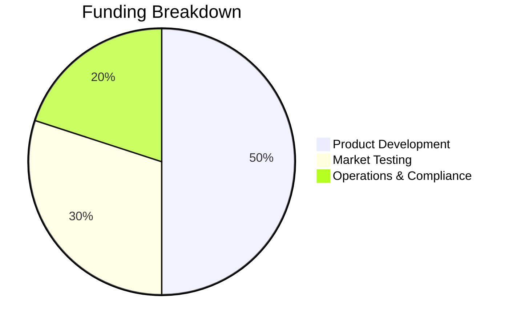

# MamaGuard: AI-Powered Maternal Risk Detection & Care Continuity Platform

## 1. Idea & Concept

Maternal mortality remains one of the most urgent public health challenges in Kenya and many other low-resource settings. Many women experience preventable complications because early warning signs are missed, follow-up appointments are not tracked consistently, and frontline health workers often operate with limited time, limited data, and limited decision support.

MamaGuard addresses this problem by combining artificial intelligence, clinical decision support, and patient follow-up automation into a single practical platform. The system helps nurses and community health workers identify high-risk maternal cases earlier, explain why a patient is flagged, and trigger timely outreach so that patients receive the care they need before complications worsen.

What makes MamaGuard original is not simply prediction, but the combination of three capabilities in one solution:
- Early risk detection from routine maternal health data
- Explainable AI that builds trust for clinicians
- Automated follow-up communication to keep mothers engaged with care

This makes the product especially relevant for clinics that need a low-cost, scalable, and usable digital assistant rather than a complex enterprise system.

---

## 2. Demonstrate Your Solution

MamaGuard works as a clinician-facing dashboard and decision support system built around a clear workflow:

1. Patient registration and baseline information capture
2. Entry of vital signs such as blood pressure, blood sugar, temperature, and heart rate
3. Real-time validation of abnormal values and risk signals
4. AI assessment that classifies patients into low, mid, or high risk
5. Explainable outputs showing the key drivers of the prediction
6. Automated follow-up actions including appointment scheduling and patient communication

The solution is powered by a predictive engine that uses machine learning models such as XGBoost and Random Forest, supported by SHAP-based explainability. This means the system does more than produce a risk score; it tells the clinician why a patient was flagged and what action should be taken.

This is a major advantage over traditional alternatives because many existing systems either:
- focus only on data storage without decision support
- provide predictions without understandable reasoning
- require expensive infrastructure or technical expertise

MamaGuard is technically stronger because it is designed for practical use in real-world clinics: it is lightweight, explainable, and suitable for rapid deployment with minimal setup.

---

## 3. Emphasize Social Impact

MamaGuard creates measurable social value by improving maternal health outcomes at the point of care.

### Direct Benefits
- Earlier identification of high-risk pregnancies
- Faster escalation of dangerous cases
- Better continuity of care through reminders and follow-up
- Reduced missed appointments and lost opportunities for intervention
- Support for overstretched nurses and community health workers

### Impact on Recipients
For mothers, the platform helps ensure that warning signs do not go unnoticed and that care remains connected even when visits are missed. For clinics, it improves workflow efficiency, improves prioritization, and supports better use of limited staff time. For communities, it strengthens trust in local healthcare systems and reduces preventable maternal complications.

### Scalability Plan
The system is designed for expansion from a pilot clinic to a regional model through:
- deployment in more health facilities
- integration with local health outreach teams
- support for multilingual and mobile-first messaging
- gradual expansion into broader maternal and child health services

This creates a scalable pathway from a single-site pilot to a larger public health intervention with national reach potential.

---

## 4. Prove Feasibility & Implementation

MamaGuard is feasible because it is built on a practical and low-cost technology stack that can be implemented in stages.

### Required Resources
- Software development team for dashboard, model training, and backend services
- Clinical advisory support to validate the workflow and outputs
- Data science support for model improvement and validation
- Basic hosting and deployment infrastructure
- Partnerships with clinics and health workers for pilot deployment

### Funding Needs
The project requires funding for product development, pilot deployment, compliance, and operational readiness.

### Implementation Timeline

| Phase | Duration | Focus |
|---|---:|---|
| Phase 1 | 1 month | Requirements gathering, workflow design, and pilot planning |
| Phase 2 | 2 months | MVP development, dashboard setup, and model integration |
| Phase 3 | 1 month | Pilot testing with clinics and health workers |
| Phase 4 | 1 month | User feedback, refinement, training, and launch preparation |

This timeline is realistic and achievable for a focused implementation team.

---

## 5. Showcase Team Competencies

Our team is well suited for this project because it combines technical, clinical, and implementation strengths.

### Team Roles and Strengths
- Project Lead: strategic oversight, stakeholder communication, and coordination
- Machine Learning Engineer: model design, training, evaluation, and explainability
- Software Developer: dashboard development, database integration, and deployment
- Clinical/Health Advisor: maternal health workflow guidance and practical validation
- Operations and Product Support: user onboarding, pilot coordination, and adoption planning

### Why This Team Fits the Project
This project requires more than coding; it requires an understanding of health systems, user behavior, risk communication, and deployment realities. Our team’s combined skills make us well positioned to build a usable solution that is not only technically impressive but also operationally realistic.

---

## 6. Deliver a Professional Presentation

A strong presentation should be clear, confident, and focused on outcomes.

### Presentation Principles
- Open with the problem and why it matters
- Present MamaGuard as a practical solution, not just an idea
- Show the workflow clearly and simply
- Highlight measurable impact and readiness for deployment
- End with a confident ask and a clear next step

Professional delivery matters because judges are not only evaluating the innovation, but also the ability to communicate it with clarity, structure, and credibility.

---

## 7. Outline Financial Feasibility

MamaGuard presents a compelling opportunity because it targets a high-need market with strong social value and clear pathways to adoption.

### Market Opportunity
The maternal health technology space in Kenya and similar markets is growing as governments, NGOs, and health providers increasingly seek digital tools that improve care delivery and strengthen community outreach. A product that supports frontline workers with low-cost decision support is highly relevant.

### Revenue Potential
Potential revenue streams include:
- pilot licensing for clinics and health organizations
- annual subscriptions for deployment and support
- partnerships with public health programs and NGOs
- future expansion into broader maternal and child health platforms

### Illustrative Financial Projection

| Year | Estimated Users/Deployments | Estimated Revenue |
|---|---:|---:|
| Year 1 | 10 pilot sites | $80,000 |
| Year 2 | 25 sites | $220,000 |
| Year 3 | 60 sites | $500,000 |

These numbers are realistic for a focused early-stage deployment if the MVP is validated successfully and adopted by partner clinics.

---

## 8. Provide a Concrete Development Plan

### Next Steps to Build the Solution
1. Finalize MVP workflow and feature priorities
2. Strengthen the prediction engine with real clinical data
3. Improve the dashboard experience for nurses and community health workers
4. Add deployment-ready communication and monitoring workflows
5. Run a local pilot and collect user feedback

### MVP Milestones
- Functional patient registration and vitals entry
- AI-based risk assessment with explanation
- Basic follow-up and communication workflow
- Pilot deployment in one or more clinics

### Roadmap Beyond MVP
- expand to multilingual support
- connect with broader health information systems
- add more advanced analytics and monitoring dashboards
- develop partnerships for wider rollout

---

## 9. The Ask

We are seeking funding to accelerate the development and pilot deployment of MamaGuard.

### Funding Request
We request $150,000 in seed support to build and validate the MVP and prepare for pilot launch.

### Resource Utilization Breakdown

### Immediate Allocation
- Product Development: 50% allocated to MVP development, integration, and deployment readiness
- Market Testing: 30% for local pilot deployment, onboarding, and validation with healthcare partners
- Operations & Compliance: 20% for essential regulatory, data handling, and operational support

This funding will allow us to move from prototype to a credible, tested, and adoption-ready maternal health solution.

---

## Closing Statement

MamaGuard is more than a technology project; it is a practical health innovation designed to protect mothers, strengthen frontline care, and make maternal risk detection more timely, explainable, and actionable. With the right support, this solution can become a powerful tool for healthier outcomes and broader access to maternal care.
